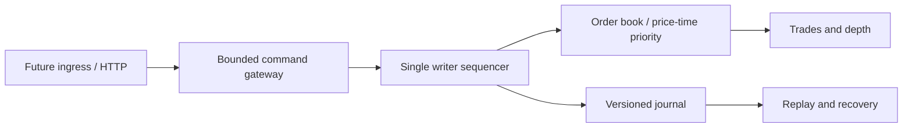

# MATCHLINE

**A deterministic exchange-style matching engine simulator, under development.**

MATCHLINE is a learning-oriented backend systems project focused on price-time priority, deterministic command ordering, crash recovery and measurable performance. It is **not** a trading venue; it never connects to an exchange or moves money.

> **Status: Commit 04 / in-memory limit-order matching.** The project now has a Java 21 matching core with price-time priority, partial/multiple fills, immutable maker-priced trade values, and order-ID indexing. It does **not yet** support cancellation, lifetime duplicate-ID tracking, concurrent ingress, a journal, HTTP or a browser demo. These remain future increments.

## Canonical development environment

- **Source files:** WSL2 Ubuntu Linux filesystem, e.g. `~/Stuff/Projects/MATCHLINE` (not `/mnt/c/...`).
- **JDK:** a Linux JDK 21 installed in WSL and selected as the Project SDK in IntelliJ.
- **Build:** Gradle **8.14.3** via `./gradlew` / `gradlew.bat`; Gradle Kotlin DSL. You do not need system Gradle.
- **IDE:** IntelliJ IDEA Community, using the WSL JDK and Gradle wrapper.
- **Docker (optional for this commit):** Docker Desktop with WSL2 integration. The container runs a **one-shot CLI smoke test**, not a server.

**Gradle wrapper:** The official Gradle 8.14.3 wrapper JAR was downloaded and SHA-256 verified in the user's WSL environment. Ensure it is tracked in the Git repository. The initial bootstrap scripts remain for clean environments. See [wrapper details](gradle/wrapper/README.md). An internet connection is necessary for first Gradle dependency downloads.

## Run and verify

```bash
java -version
chmod +x ./gradlew
./gradlew --version
./gradlew clean test
./gradlew run --args='--self-check'
./gradlew run --args='--version'
./gradlew installDist
./build/install/matchline/bin/matchline --self-check
```

Expected output from the self-check (JDK feature may be newer if you intentionally use a newer compatible JVM):

```text
MATCHLINE BOOTSTRAP OK | Java 21
matching=true http=false journal=false
```

Expected after Commit 04: **107 passing JUnit cases** (79 previously verified through Commit 03, plus 28 matching cases). Gradle writes HTML test results to `build/reports/tests/test/index.html` and XML to `build/test-results/test/`. The user verifies the exact counts on their machine.

There is no HTTP health endpoint yet. Running `curl localhost:8080` is **not** an appropriate test for Commit 04.

## Docker smoke test (optional)

```bash
docker compose --profile smoke run --build --rm matchline-smoke
```

The container builds the app, prints the same bootstrap OK message and exits successfully. It is **not** intended to stay running.

## Architecture (target, not present implementation)



Planned separation: core Java code holds domain rules; adapters handle HTTP and storage; state changes are made only by a sequenced writer per book. No database or network call enters the matching hot path. The plain-Java domain and in-memory price-time matching core exist; the single-writer gateway and persistence remain future work.

For the roadmap and design rationale, see [`docs/roadmap.md`](docs/roadmap.md) and [`docs/adr`](docs/adr). For the current change application and Git commands, see [`docs/COMMIT-04-HANDOFF.md`](docs/COMMIT-04-HANDOFF.md).

## Current domain contract and limitations

- `PlaceLimitOrder(instrument, orderId, side, price, quantity)` and `CancelOrder(instrument, orderId)` are immutable validated requests. **Only** placing a limit order is currently executable through `LimitOrderBook.executeLimit`; no journal or public command gateway exists.
- Instrument: 1–12 ASCII uppercase characters, starting A–Z; IDs: 1–64 ASCII characters, starting alphanumeric. Neither is normalized. The planned initial instrument is `DEMO`.
- Price: whole ticks from **1 to 1,000,000,000**; new-order quantity: **1 to 1,000,000**. Invalid inputs fail fast with machine-readable rejection codes. No floating-point arithmetic.
- Maximum **per-order** abstract tick-notional is `10^15`; it is not a currency amount. Totals across orders must still be checked.
- The book rejects **currently resting** duplicate IDs; reuse of a fully executed ID is still possible. Lifetime uniqueness and cancellation are Commit 05 work. See [ADR 0003](docs/adr/0003-bounded-order-contracts.md).

## Current in-memory matching book (Commits 03–04)

`dev.matchline.book.LimitOrderBook` stores resting orders and now executes one in-memory limit order at a time:

```java
var book = new LimitOrderBook(new InstrumentId("DEMO"));
book.addResting(new PlaceLimitOrder(
    new InstrumentId("DEMO"), new OrderId("B1"), Side.BUY,
    new PriceTicks(100), new OrderQuantity(4)));
var result = book.executeLimit(new PlaceLimitOrder(
    new InstrumentId("DEMO"), new OrderId("S1"), Side.SELL,
    new PriceTicks(99), new OrderQuantity(3)));
// A trade against B1 for quantity 3 executes at B1's resting price (100).
var trades = result.trades();
var bestBid = book.bestOrder(Side.BUY);
var bidDepth = book.depth(Side.BUY, 10);
var fifoAt100 = book.ordersAt(Side.BUY, new PriceTicks(100));
```

- `TreeMap` per side (BUY descending, SELL ascending), `LinkedHashMap` FIFO per level, and an active order-ID `HashMap` indexing the same internal mutable orders.
- Add to an existing price level and lookup by ID: expected O(1); creating a new price level: O(log P), where P = price levels. Best-price access: O(log P) worst-case. A depth/queue read is proportional to the result size.
- `executeLimit` matches crossed makers at their resting prices, preserving FIFO on partial fills and removing fully filled makers from both indexes. It rests any unmatched remainder behind existing orders at its price. Rejection preflight handles instrument mismatch, active duplicate IDs and no-capacity remainders **before any mutation**. Lifetime ID reuse prohibition remains for Commit 05.
- The older `addResting` methods are retained for controlled seeding and residual storage. They still reject crossed insertion rather than executing it.
- Default capacity 50,000 resting orders/book (hard configuration ceiling 100,000); `depth` accepts 1..1,000 levels. Read views/lists are immutable; the book itself is **not thread-safe**, pending the sequencer.
- Local insertion ordinals exist only to explain FIFO: they are not acceptance sequence IDs, persisted journal offsets or durability acknowledgements.

See [ADR 0004](docs/adr/0004-price-level-order-book.md), [ADR 0005](docs/adr/0005-in-memory-matching-and-capacity.md), and [Commit 04 handoff](docs/COMMIT-04-HANDOFF.md).

## Current limitations

- In-memory limit matching is implemented, but there is no cancellation, lifetime deduplication, command sequencer or journalled acceptance.
- No HTTP API, SSE, persistence, journal replay, recovery snapshot or benchmark. Reapplying an identical in-memory list in a test is NOT crash recovery.
- Not thread-safe; only the owning thread may touch the book. The CLI has a self-check, not an interactive order-placement interface.
- No production suitability, deployment URL, latency number or throughput claim.
- Initial dependency downloads require internet access. `MANIFEST.sha256` is the historical **Commit 01 bootstrap ZIP** integrity manifest, not a rolling source-tree digest.

## License

MIT — see [`LICENSE`](LICENSE).
