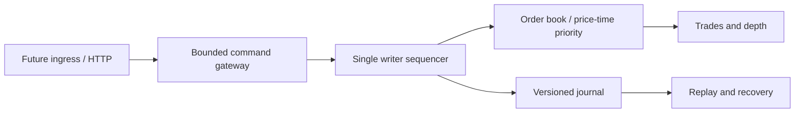

# MATCHLINE

**A deterministic exchange-style matching engine simulator, under development.**

MATCHLINE is a learning-oriented backend systems project focused on price-time priority, deterministic command ordering, crash recovery and measurable performance. It is **not** a trading venue; it never connects to an exchange or moves money.

> **Status: Commit 02 / domain contracts.** The project has a runnable Java bootstrap, validated immutable order-command types, and unit tests. It does **not yet** process orders, match trades, maintain an order book, journal commands, expose HTTP, or serve a browser demo. Those are planned, not complete features.

## Canonical development environment

- **Source files:** WSL2 Ubuntu Linux filesystem, e.g. `~/Stuff/Projects/MATCHLINE` (not `/mnt/c/...`).
- **JDK:** a Linux JDK 21 installed in WSL and selected as the Project SDK in IntelliJ.
- **Build:** Gradle **8.14.3** via `./gradlew` / `gradlew.bat`; Gradle Kotlin DSL. You do not need system Gradle.
- **IDE:** IntelliJ IDEA Community, using the WSL JDK and Gradle wrapper.
- **Docker (optional for this commit):** Docker Desktop with WSL2 integration. The container runs a **one-shot CLI smoke test**, not a server.

**Gradle wrapper:** The official Gradle 8.14.3 wrapper JAR was downloaded and SHA-256 verified in the user's WSL environment. Ensure it is tracked in the Git repository. The initial bootstrap scripts remain for clean environments. See [wrapper details](gradle/wrapper/README.md). An internet connection is necessary for first Gradle dependency downloads.

## Run and verify

```bash
java -version
chmod +x ./gradlew
./gradlew --version
./gradlew clean test
./gradlew run --args='--self-check'
./gradlew run --args='--version'
./gradlew installDist
./build/install/matchline/bin/matchline --self-check
```

Expected output from the self-check (JDK feature may be newer if you intentionally use a newer compatible JVM):

```text
MATCHLINE BOOTSTRAP OK | Java 21
matching=false http=false journal=false
```

Expected: **all 7 original JUnit cases and the new domain cases pass**. Gradle writes HTML test results to `build/reports/tests/test/index.html` and XML to `build/test-results/test/`. The user verifies the exact counts on their machine.

There is no HTTP health endpoint yet. Running `curl localhost:8080` is **not** an appropriate test for Commit 02.

## Docker smoke test (optional)

```bash
docker compose --profile smoke run --build --rm matchline-smoke
```

The container builds the app, prints the same bootstrap OK message and exits successfully. It is **not** intended to stay running.

## Architecture (target, not present implementation)



Planned separation: core Java code holds domain rules; adapters handle HTTP and storage; state changes are made only by a sequenced writer per book. No database or network call enters the matching hot path. Only the plain-Java domain validation and command records exist; the rest is future work.

For the roadmap and design rationale, see [`docs/roadmap.md`](docs/roadmap.md) and [`docs/adr`](docs/adr). For the current change application and Git commands, see [`docs/COMMIT-02-HANDOFF.md`](docs/COMMIT-02-HANDOFF.md).

## Current domain contract (no execution yet)

- `PlaceLimitOrder(instrument, orderId, side, price, quantity)` and `CancelOrder(instrument, orderId)` are immutable validated requests. Neither executes or journals anything.
- Instrument: 1–12 ASCII uppercase characters, starting A–Z; IDs: 1–64 ASCII characters, starting alphanumeric. Neither is normalized. The planned initial instrument is `DEMO`.
- Price: whole ticks from **1 to 1,000,000,000**; new-order quantity: **1 to 1,000,000**. Invalid inputs fail fast with machine-readable rejection codes. No floating-point arithmetic.
- Maximum **per-order** abstract tick-notional is `10^15`; it is not a currency amount. Totals across orders must still be checked.
- The future book will enforce order-ID uniqueness and handle state-dependent rejections. See [ADR 0003](docs/adr/0003-bounded-order-contracts.md).

## Current limitations

- No order book, matching execution, cancel processing, command sequencing or journalled acceptance.
- No HTTP API, SSE, persistence, replay, snapshot or benchmark.
- No production suitability, deployment URL, latency number or throughput claim.
- Initial dependency downloads require internet access. `MANIFEST.sha256` is the historical **Commit 01 bootstrap ZIP** integrity manifest, not a rolling source-tree digest.

## License

MIT — see [`LICENSE`](LICENSE).
