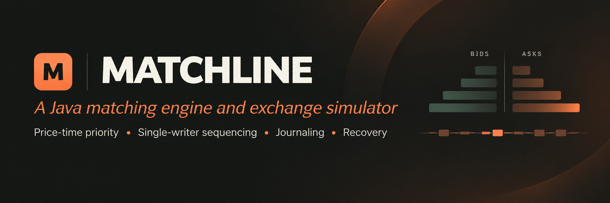
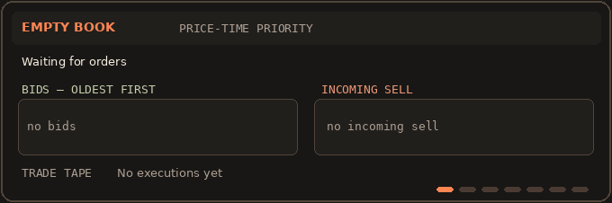
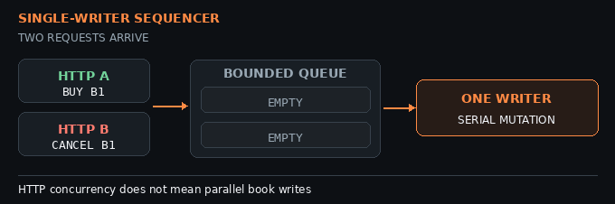
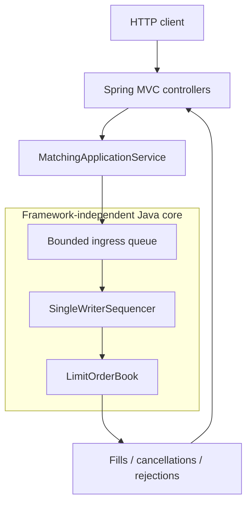
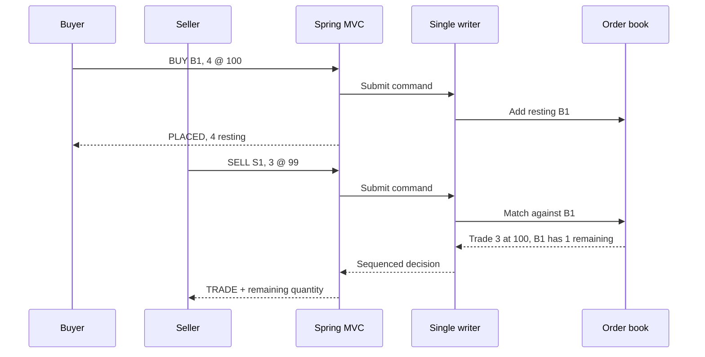

<div align="center">
  
  <p><strong>A limit-order matching engine built with Java 21. Spring Boot at the edge; deterministic Java at the core.</strong></p>
  <p><a href="https://matchline-kz8p.onrender.com/lab">Live exchange lab</a> · <a href="https://matchline-kz8p.onrender.com/embed">Interactive demo</a> · <a href="docs/SPRING-MIGRATION-ROADMAP.md">Spring migration</a> · <a href="docs/ENGINEERING_REFERENCE.md">Engineering reference</a></p>
</div>

## What is MATCHLINE?

In an exchange, **buyers name their maximum price** and **sellers name their minimum price**. These prices are *not fixed*. A **matching engine** decides which compatible orders trade, and in what order.

MATCHLINE simulates that decision-making for a fictional instrument, `DEMO`. Prices are integer **ticks** (not real currency).

<div align="center">
  
  <p><sub>Best price first. At the same price, oldest order first (FIFO).</sub></p>
</div>

Example: `BUY 4 @ 100` rests in the book. `SELL 3 @ 99` arrives. They trade **3 @ 100**, the resting order's price. One buy unit remains. This is called a **partial fill**.

## What makes this a backend project?

- **Correctness:** `TreeMap` price levels, FIFO queues at each price, and fast order-ID lookup.
- **Concurrency:** one writer assigns a strict order to concurrent commands; readers get ordered snapshots.
- **Backpressure:** a bounded ingress queue rejects overload instead of growing without limit.
- **Recovery:** optional binary command/decision journal, checksums, snapshots, and deterministic replay.
- **Performance:** bounded metrics, Prometheus exposition, JMH and repeatable HTTP measurements.

<div align="center">
  
  <p><sub>Concurrent requests are admitted into one ordered writer; the order book is not modified from HTTP threads.</sub></p>
</div>

## Architecture



**Spring Boot** handles HTTP, configuration, lifecycle, and Actuator. **Plain Java** owns matching and sequencing. The Spring code never mutates the order book directly.

### One trade, end to end



## Run locally

**Requirements:** Java 21, Gradle wrapper, IntelliJ IDEA Community (optional), WSL/Linux supported.

1. Open `dev.matchline.spring.MatchlineSpringApplication` in IntelliJ and click **Run**. Spring starts on `localhost:8082`.
2. Run the JUnit tests using IntelliJ's gutter icons or saved Gradle test configuration.
3. From WSL, run the executable API check:

```bash
bash scripts/smoke-spring-orders.sh
```

Or try an order directly:

```bash
curl -sS -X POST http://127.0.0.1:8082/api/v1/orders \
  -H 'Content-Type: application/json' \
  -d '{"instrument":"DEMO","orderId":"B1","side":"BUY","priceTicks":100,"quantity":4}'
```

**Spring endpoints (S04):** `POST /api/v1/orders`, `POST /api/v1/orders/{id}/cancel`, `GET /api/v1/orders/{id}`, `GET /api/v1/book`, `GET /api/v1/health`, `/actuator/health`, `/actuator/prometheus` (local mode only), `/api/v1/dashboard`, `/api/v1/trades`, `/api/v1/events`, `/api/v1/status`, `/api/v1/recovery`, and `POST /api/v1/session` in public-demo mode.

## Current migration boundary

| Spring Boot (local, port 8082) | Existing public demo (Render) |
|---|---|
| Spring MVC REST and `/lab`, `/embed`, `/preview`; optional isolated demo sessions | Proven Java HTTP adapter, isolated visitor sessions, `/lab`, `/embed`, `/preview` |
| Default: one volatile writer. With `MATCHLINE_PUBLIC_DEMO=true`: up to 12 isolated volatile sessions | Journal/recovery available in separate local CLI mode; hosted sessions are **volatile** |

To test Spring's visitor mode: add `MATCHLINE_PUBLIC_DEMO=true` to your IntelliJ Spring run configuration, restart, then run `bash scripts/smoke-spring-demo.sh`. To allow portfolio framing locally, set `MATCHLINE_EMBED_ORIGIN=https://portfolio.jhethia.workers.dev` as well.

Both paths use the same plain-Java matching core. **The live Render service has not yet switched to Spring Boot.** This is a single-process educational simulator, not a distributed exchange or production trading platform.

## Source and documentation

| Read | For |
|---|---|
| [Engineering reference](docs/ENGINEERING_REFERENCE.md) | Detailed CLI, journal, recovery, limits and performance notes |
| [Architecture decisions](docs/adr/) | Why each key data structure and concurrency policy exists |
| [Spring S04 handoff](docs/SPRING-S04-HANDOFF.md) | Session routing, UI policies, verification and limitations |
| [Spring migration roadmap](docs/SPRING-MIGRATION-ROADMAP.md) | What's implemented vs. still planned |
| [Benchmarks](docs/benchmarks/README.md) | Methodology and actual reported results |
| [Security and public-demo limits](docs/SECURITY.md) | What the public demo does **not** guarantee |

MIT licensed — see [LICENSE](LICENSE).
