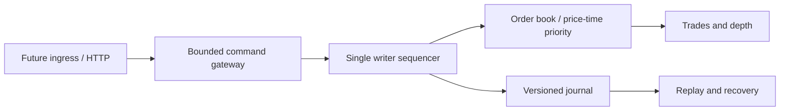

# MATCHLINE

**A deterministic exchange-style matching engine simulator, under development.**

MATCHLINE is a learning-oriented backend systems project focused on price-time priority, deterministic command ordering, crash recovery and measurable performance. It is **not** a trading venue; it never connects to an exchange or moves money.

> **Status: Commit 07 / append-only versioned command/outcome journal.** The Java 21 matching core, cancellation, bounded single-writer ingress and optional file journaling are implemented. Replay-based restoration, snapshots, HTTP and the browser demo remain future increments. Journal crash durability depends on the configured force policy; see ADR 0008.

## Canonical development environment

- **Source files:** WSL2 Ubuntu Linux filesystem, e.g. `~/Stuff/Projects/MATCHLINE` (not `/mnt/c/...`).
- **JDK:** a Linux JDK 21 installed in WSL and selected as the Project SDK in IntelliJ.
- **Build:** Gradle **8.14.3** via `./gradlew` / `gradlew.bat`; Gradle Kotlin DSL. You do not need system Gradle.
- **IDE:** IntelliJ IDEA Community, using the WSL JDK and Gradle wrapper.
- **Docker (optional for this commit):** Docker Desktop with WSL2 integration. The container runs a **one-shot CLI smoke test**, not a server.

**Gradle wrapper:** The official Gradle 8.14.3 wrapper JAR was downloaded and SHA-256 verified in the user's WSL environment. Ensure it is tracked in the Git repository. The initial bootstrap scripts remain for clean environments. See [wrapper details](gradle/wrapper/README.md). An internet connection is necessary for first Gradle dependency downloads.

## Run and verify

```bash
java -version
chmod +x ./gradlew
./gradlew --version
./gradlew clean test
./gradlew run --args='--self-check'
./gradlew run --args='--version'
./gradlew installDist
./build/install/matchline/bin/matchline --self-check
```

Expected output from the self-check (JDK feature may be newer if you intentionally use a newer compatible JVM):

```text
MATCHLINE BOOTSTRAP OK | Java 21
matching=true http=false journal=true
```

After Commit 07, the 150 prior test invocations (reported by the user as passing after Commit 06) are supplemented by the new journal tests. This document does not claim those tests passed in the user's WSL until the user runs Gradle. Gradle writes HTML test results to `build/reports/tests/test/index.html` and XML to `build/test-results/test/`. The user verifies the exact counts on their machine.

There is no HTTP health endpoint yet. Running `curl localhost:8080` is **not** an appropriate test for Commit 07.

## Docker smoke test (optional)

```bash
docker compose --profile smoke run --build --rm matchline-smoke
```

The container builds the app, prints the same bootstrap OK message and exits successfully. It is **not** intended to stay running.

## Architecture (target, not present implementation)



Current separation: core Java code holds matching rules; a sequenced writer can optionally append binary journal frames to disk. A forced disk write adds I/O to the command path by design. HTTP and recovery snapshots are future work.

For the roadmap and design rationale, see [`docs/roadmap.md`](docs/roadmap.md) and [`docs/adr`](docs/adr). For the current change application and Git commands, see [`docs/COMMIT-07-HANDOFF.md`](docs/COMMIT-07-HANDOFF.md).

## Current domain contract and limitations

- `PlaceLimitOrder(instrument, orderId, side, price, quantity)` and `CancelOrder(instrument, orderId)` are immutable validated requests. Both placing a limit order (`LimitOrderBook.executeLimit`) and cancelling a resting remainder (`LimitOrderBook.cancel`) are executable in memory; a journaled sequencer exists, but no HTTP gateway is present.
- Instrument: 1–12 ASCII uppercase characters, starting A–Z; IDs: 1–64 ASCII characters, starting alphanumeric. Neither is normalized. The planned initial instrument is `DEMO`.
- Price: whole ticks from **1 to 1,000,000,000**; new-order quantity: **1 to 1,000,000**. Invalid inputs fail fast with machine-readable rejection codes. No floating-point arithmetic.
- Maximum **per-order** abstract tick-notional is `10^15`; it is not a currency amount. Totals across orders must still be checked.
- The book rejects **all previously accepted** placement IDs within the same book instance, including fully executed/cancelled IDs. ID history is capped at 1,000,000 accepted orders by default (configurable to 2,000,000 maximum); accepted placement commands are journaled when enabled, but restoring the ID history waits for Commit 08. Unknown or previously completed cancel targets reject with `ORDER_NOT_FOUND`. See [ADR 0006](docs/adr/0006-cancellation-id-history-and-amend-policy.md).

## Current in-memory matching book (Commits 03–05)

`dev.matchline.book.LimitOrderBook` stores resting orders and now executes one in-memory limit order at a time:

```java
var book = new LimitOrderBook(new InstrumentId("DEMO"));
book.addResting(new PlaceLimitOrder(
    new InstrumentId("DEMO"), new OrderId("B1"), Side.BUY,
    new PriceTicks(100), new OrderQuantity(4)));
var result = book.executeLimit(new PlaceLimitOrder(
    new InstrumentId("DEMO"), new OrderId("S1"), Side.SELL,
    new PriceTicks(99), new OrderQuantity(3)));
// A trade against B1 for quantity 3 executes at B1's resting price (100).
var trades = result.trades();
var cancelled = book.cancel(new dev.matchline.domain.CancelOrder(
    new InstrumentId("DEMO"), new OrderId("B1")));
// The remaining 1 unit of B1 is cancelled; B1 can never be reused in this book.
var bestBid = book.bestOrder(Side.BUY);
var bidDepth = book.depth(Side.BUY, 10);
var fifoAt100 = book.ordersAt(Side.BUY, new PriceTicks(100));
```

- `TreeMap` per side (BUY descending, SELL ascending), `LinkedHashMap` FIFO per level, and an active order-ID `HashMap` indexing the same internal mutable orders.
- Add to an existing price level and lookup by ID: expected O(1); creating a new price level: O(log P), where P = price levels. Best-price access: O(log P) worst-case. A depth/queue read is proportional to the result size.
- `executeLimit` matches crossed makers at their resting prices, preserving FIFO on partial fills and removing fully filled makers from both indexes. It rests any unmatched remainder behind existing orders at its price. Rejection preflight handles instrument mismatch, active duplicate IDs and no-capacity remainders **before any mutation**. Lifetime ID reuse prohibition is now enforced with a bounded in-memory ID history.
- The older `addResting` methods are retained for controlled seeding and residual storage. They still reject crossed insertion rather than executing it, and now also consume IDs from the same lifetime history.
- Default capacity 50,000 resting orders/book (hard configuration ceiling 100,000); `depth` accepts 1..1,000 levels. Read views/lists are immutable; the book itself is **not thread-safe**; the sequencer is its safe ingress path.
- Local insertion ordinals exist only to explain FIFO: they are not acceptance sequence IDs, persisted journal offsets or durability acknowledgements.

Cancels remove only outstanding quantity, not past trades, and can eliminate a price level. There is **no amend command**; cancel + place a new ID loses FIFO priority and is not atomic. See [ADR 0004](docs/adr/0004-price-level-order-book.md), [ADR 0005](docs/adr/0005-in-memory-matching-and-capacity.md), [ADR 0006](docs/adr/0006-cancellation-id-history-and-amend-policy.md), and [Commit 05 handoff](docs/COMMIT-05-HANDOFF.md).

## Bounded single-writer ingress (Commit 06)

`dev.matchline.sequencer.SingleWriterSequencer` **privately creates and owns** one
book. Submission is non-blocking and returns a ticket with a gapless in-memory
admission sequence. Awaiting the completion future returns an ordered decision.

```java
import dev.matchline.sequencer.*;
import java.util.concurrent.TimeUnit;

try (var engine = new SingleWriterSequencer(new InstrumentId("DEMO"), 1024)) {
    var ticket = engine.submit(new PlaceLimitOrder(
        new InstrumentId("DEMO"), new OrderId("B1"), Side.BUY,
        new PriceTicks(100), new OrderQuantity(4)));
    SequencedResult result = ticket.completion().toCompletableFuture().get(5, TimeUnit.SECONDS);
    // result.sequence() == 1, result.decision() is a CommandDecision.Placed
    BookReadView read = engine.inspect(10).get(5, TimeUnit.SECONDS);
}
```

Queue overload (`INGRESS_OVERLOADED`) and closed ingress (`INGRESS_CLOSED`)
reject synchronously and **do not** consume a sequence. A successfully queued
command that later fails business validation **does** consume a sequence and
returns `CommandDecision.Rejected`. Reads run in queue order on the writer but
do not consume command sequence numbers. Without a journal, completion confirms
**only volatile processing**; with `SYNC_EACH_RECORD`, completion follows two
forced records (command plus outcome). `stopAccepting()` drains
already queued work; `close()` waits for graceful termination (10-second limit).
Read [ADR 0007](docs/adr/0007-single-writer-ingress-and-acknowledgements.md)
and [Commit 06 handoff](docs/COMMIT-06-HANDOFF.md) for precise concurrency
and lifecycle semantics.

## Append-only file journal (Commit 07)

The journal is optional, explicit and attached **only to a new empty book**. Create a parent directory outside the Git repository or under the ignored `local-data/` directory:

```java
import dev.matchline.journal.*;
import dev.matchline.sequencer.*;
import dev.matchline.domain.InstrumentId;
import java.nio.file.Path;

var symbol = new InstrumentId("DEMO");
var journal = FileCommandJournal.createNew(
    Path.of("local-data/demo.mlj"), symbol, DurabilityPolicy.SYNC_EACH_RECORD);
try (var engine = new SingleWriterSequencer(symbol, 1024, 50_000, 1_000_000, journal)) {
    // submit validated commands and await ticket.completion() as in Commit 06
}
JournalScan scan = FileCommandJournal.scan(
    Path.of("local-data/demo.mlj"), TailPolicy.STRICT);
// scan.entries(): alternating command and outcome records, except a pending last command
```

`createNew` never overwrites an existing file. `SYNC_EACH_RECORD` forces the command record **before** matching and forces its outcome **before** completing the future. `OS_BUFFERED` is faster in principle but does **not** promise crash durability. In either mode, the admission ticket is not a durable acknowledgement. CRC32C protects every record against accidental corruption. A complete bad-CRC frame is always fatal. Offline `TRUNCATE_INCOMPLETE_TAIL` can explicitly discard just a partially written final frame; the remaining `Command` (if any) is reported as **pending/ambiguous**. Never invoke offline repair while the writer is running. Read [ADR 0008](docs/adr/0008-versioned-journal-and-durability.md) before interpreting crash outcomes.

**There is deliberately no restore-from-existing-journal path yet.** Reopening an old journal into a new empty book would be unsafe: replay and state equivalence are Commit 08. Do not delete/overwrite an old journal just to restart. The journal is an append-only single-file development format; full recovery, compaction and version migrations are not present.

## Current limitations

- The volatile sequencer mode still loses data on crash. The synchronous journal writes durable command/outcome frames, but Commit 08 must reconstruct state and resolve incomplete command/outcome pairs after restart.
- No HTTP API, SSE, journal replay, recovery snapshot or benchmark. Reapplying an identical in-memory list in a test is NOT crash recovery.
- The raw `LimitOrderBook` remains single-thread-owned and unsafe for direct concurrent callers. Use `SingleWriterSequencer` for concurrent admission and owner-thread read access. The CLI has a self-check, not an interactive order-placement interface.
- No production suitability, deployment URL, latency number or throughput claim.
- Initial dependency downloads require internet access. `MANIFEST.sha256` is the historical **Commit 01 bootstrap ZIP** integrity manifest, not a rolling source-tree digest.

## License

MIT — see [`LICENSE`](LICENSE).
