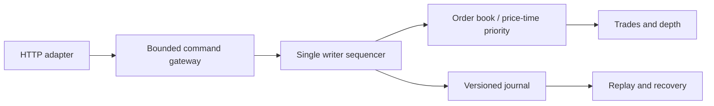

# MATCHLINE

**A deterministic exchange-style matching engine simulator, under development.**

MATCHLINE is a learning-oriented backend systems project focused on price-time priority, deterministic command ordering, crash recovery and measurable performance. It is **not** a trading venue; it never connects to an exchange or moves money.

> **Status: Commit 11 / interactive laboratory delivered for browser verification.** The Java 21 matching engine, single-writer ingress, journal/replay/snapshots, HTTP adapter, JMH harness and operational metrics are implemented. The full browser lab and read-only preview now use the real HTTP engine; visual browser testing, actual JMH measurements, hardened public ingress and hosting remain user verification/release work. This is an exchange **simulator**, never real trading infrastructure.

## Interactive Exchange Laboratory (Commit 11)

With the real HTTP server running (`./gradlew run --args='--serve' --no-daemon --max-workers=1 --console=plain`), open:

- **Full lab:** <http://127.0.0.1:8080/lab> — place/cancel orders, inspect bid/ask depth, executions, recent commands, metrics and recovery state; step through three deterministic command *scripts*.
- **Compact read-only preview:** <http://127.0.0.1:8080/preview> — a responsive, continuously refreshed slice of the **same server** for later portfolio embedding.

Both are served as classpath resources from the Java 21 server; there is no frontend build, CDN, separate JavaScript matching engine, or cross-origin API configuration. The UI polls the real book and process-local tapes every four seconds (five seconds in preview). Pausing an inactive tab reduces requests; the server's existing global rate budget still applies. All user-visible fills and command outcomes come from the HTTP server.

**Scenario caveat:** demo scripts place real orders into the *current* book. They do not reset it or guarantee isolation from other users/orders. Run the experiments against a fresh volatile session for a controlled narrative; click each step separately and inspect the actual decision. The preview is read-only. The recovery panel displays startup verification metadata, not an on-demand replay endpoint. Recent trade/event tapes are process-local; a restart does not restore those tapes, even when the book is journal-recovered.

**Embedding defaults to forbidden.** To permit only the read-only preview to be framed by one exact portfolio HTTPS origin, export `MATCHLINE_EMBED_ORIGIN=https://your-portfolio.example` before starting the server. `/lab`, all JSON APIs, and static assets retain `frame-ancestors 'none'`. This variable does not change CORS; no CORS is needed for same-origin requests inside the iframe. A local `file://` portfolio cannot be allowlisted through CSP. The portfolio will be wired only after a real HTTPS deploy is verified. Do not bind this unauthenticated order API directly to the public internet; public deployment hardening remains Commit 12.

Run Java integration tests with `./gradlew clean test --no-daemon --max-workers=1 --console=plain`. Optional frontend pure-function tests: `node --test ui/tests/*.test.mjs` (Node 20+; no npm install). See [Commit 11 handoff](docs/COMMIT-11-HANDOFF.md) and [ADR 0012](docs/adr/0012-same-origin-exchange-lab.md).

## Canonical development environment

- **Source files:** WSL2 Ubuntu Linux filesystem, e.g. `~/Stuff/Projects/MATCHLINE` (not `/mnt/c/...`).
- **JDK:** a Linux JDK 21 installed in WSL and selected as the Project SDK in IntelliJ.
- **Build:** Gradle **8.14.3** via `./gradlew` / `gradlew.bat`; Gradle Kotlin DSL. You do not need system Gradle.
- **IDE:** IntelliJ IDEA Community, using the WSL JDK and Gradle wrapper.
- **Docker (optional):** Docker Desktop with WSL2 integration. The `smoke` profile runs a one-shot CLI check; the `api` profile serves a loopback-published HTTP simulator.

**Gradle wrapper:** The official Gradle 8.14.3 wrapper JAR was downloaded and SHA-256 verified in the user's WSL environment. Ensure it is tracked in the Git repository. The initial bootstrap scripts remain for clean environments. See [wrapper details](gradle/wrapper/README.md). An internet connection is necessary for first Gradle dependency downloads.

## Run and verify

```bash
java -version
chmod +x ./gradlew
./gradlew --version
./gradlew clean test
./gradlew run --args='--self-check'
./gradlew run --args='--version'
./gradlew run --args='--recovery-demo'
./gradlew installDist
./build/install/matchline/bin/matchline --self-check
```

Expected output from the self-check (JDK feature may be newer if you intentionally use a newer compatible JVM):

```text
MATCHLINE BOOTSTRAP OK | Java 21
matching=true http=true journal=true
```

Commits 01–09 were verified in the user's environment. Commit 10 HTTP metrics/benchmark were exercised by the user and committed locally; the user must finish configuring the `main` upstream push, and actual JMH output has not yet been shared. Commit 11 tests and browser scenarios require user verification. Reports are written to `build/reports/tests/test/`.

Expected recovery demo output:

```text
MATCHLINE RECOVERY OK | commands=6 snapshot=4 suffix=2 full=6 state_equal=true
This is a normal-close replay demonstration; no abrupt crash or fsync guarantee was tested.
```

The HTTP service starts only with `--serve`; `--self-check` remains a one-shot CLI command.

## Commit 09 — HTTP server, OpenAPI and bounded demo controls

Start the **real Java 21 HTTP adapter**, which submits every mutation and book read to `SingleWriterSequencer`:

```bash
./gradlew run --args='--serve' --no-daemon --max-workers=1 --console=plain
# In a second WSL terminal:
curl -fsS http://127.0.0.1:8080/api/v1/health
curl -fsS http://127.0.0.1:8080/openapi.yaml
curl -fsS -X POST http://127.0.0.1:8080/api/v1/orders \
  -H 'Content-Type: application/json' \
  -d '{"instrument":"DEMO","orderId":"B1","side":"BUY","priceTicks":100,"quantity":4}'
curl -fsS -X POST http://127.0.0.1:8080/api/v1/orders \
  -H 'Content-Type: application/json' \
  -d '{"instrument":"DEMO","orderId":"S1","side":"SELL","priceTicks":99,"quantity":3}'
curl -fsS 'http://127.0.0.1:8080/api/v1/book?depth=10'
curl -fsS 'http://127.0.0.1:8080/api/v1/trades?limit=10'
curl -fsS 'http://127.0.0.1:8080/api/v1/events?limit=10'
curl -fsS http://127.0.0.1:8080/api/v1/recovery
curl -fsS -X POST http://127.0.0.1:8080/api/v1/orders/B1/cancel
```

The SELL executes three units against B1 at its **resting 100-tick price**; B1 has one unit remaining and cancellation removes it. Run this walkthrough on a **fresh volatile session**; existing persistent data may change the result. `POST /api/v1/orders` responds 200 for a processed placement, including `sequence`, `executedQuantity`, `restingQuantity`, `trades` and `durable`; it responds 409 with a **sequenced** `REJECTED` decision for a duplicate ID. Invalid input receives a structured 4xx without consuming a sequence. Admission overload returns 429. A command with an unconfirmed outcome can return 504 with its admitted sequence; **never blindly retry**.

**IntelliJ HTTP requests:** Use the version-controlled collection in [`http/`](http/README.md) for the end-to-end matching flow, FIFO/multi-fills, diagnostics, and optional token-guarded demo reset. No Postman collection is required.

Supported endpoints: `GET /api/v1/health`, `POST /api/v1/orders`, `GET /api/v1/orders/{id}`, `POST /api/v1/orders/{id}/cancel`, `GET /api/v1/book?depth=10`, `GET /api/v1/trades?limit=50`, `GET /api/v1/events?limit=50`, `GET /api/v1/status`, `GET /api/v1/recovery`, and token-guarded `POST /api/v1/demo/reset`. The OpenAPI 3.0 document is served at [`/openapi.yaml`](src/main/resources/openapi.yaml). Only instrument `DEMO` is currently supported. Trades and events are **bounded, process-local HTTP-observed tapes** (2,048 compact decisions and 2,048 fills), not full durable audit history; after recovery they intentionally start empty. `/api/v1/recovery` exposes the **last startup recovery report**, not a live on-demand replay.

By default the listener binds **127.0.0.1:8080**, accepts no cross-origin browser requests, and has **no reset token**. The server has a 4,096-byte request limit, 64 concurrent request permits, a global token budget of 240 requests burst / 4 requests per second, and a 5-second writer acknowledgement deadline. These are **demo safeguards, not production DDoS protection or authentication**. Server-side order submission is unauthenticated; do **not** expose this directly to the public internet. Explicit deployment hardening and public ingress are later commits. See [ADR 0010](docs/adr/0010-http-ingress-and-demo-reset.md).

Configuration uses environment variables (see [`.env.example`](.env.example); it is not automatically loaded):

```bash
# Start an append-only, fsync-per-record journal in an ignored local-data dir:
mkdir -p local-data
MATCHLINE_JOURNAL_PATH=local-data/demo.mlj \
MATCHLINE_SNAPSHOT_PATH=local-data/demo.mls \
./gradlew run --args='--serve' --no-daemon --max-workers=1 --console=plain
```

On first startup it creates the journal; on subsequent starts it **strictly** verifies journal and snapshot, resolves a final pending command, and recovers state before accepting HTTP traffic. Snapshot frequency is fixed at **every 100 completed decisions** in the HTTP adapter. Without a configured path, the session is intentionally volatile. `MATCHLINE_DURABILITY=OS_BUFFERED` can be set for non-durable development; response `durable=false` then reflects that policy. The default when journaling is configured is `SYNC_EACH_RECORD`. Never overwrite/repair a live journal; a torn tail requires the **offline** repair procedure documented in Commit 08.

To enable controlled volatile reset, set a secret **at least 32 characters** long in `MATCHLINE_RESET_TOKEN`, then call:

```bash
curl -fsS -X POST http://127.0.0.1:8080/api/v1/demo/reset \
  -H "Authorization: Bearer ${MATCHLINE_RESET_TOKEN}"
```

The endpoint is **404/disabled** without a token, **403** without a correct token, and **409/refused** whenever a persistent journal is configured (even with a token). A successful reset drains prior work, starts a new volatile book and sequence epoch, and increments `generation`. Do not enable this endpoint on a public service without separate authentication/network protection. CORS is off unless `MATCHLINE_ALLOWED_ORIGIN` is an exact HTTP(S) origin (no wildcard); use HTTPS and a trusted reverse proxy for any remote clients.

## Docker smoke test and local HTTP API (optional)

```bash
docker compose --profile smoke run --build --rm matchline-smoke
```

The smoke container prints bootstrap OK and exits. The separate API profile runs the Java listener, published on **host loopback only**:

```bash
docker compose --profile api up --build
# In another terminal: curl -fsS http://127.0.0.1:8080/api/v1/health
```

The example API container is intentionally **volatile**, with reset and cross-origin requests disabled; the container does not mount or persist a journal.

## Architecture (HTTP ingress through recovered single writer)



Current separation: HTTP decodes and validates bounded JSON, then queues immutable commands and writer-ordered reads. The Java core owns matching; the sequenced writer optionally records journal frames and state snapshots. Restart verifies stored history before the HTTP service becomes available.

For the roadmap and design rationale, see [`docs/roadmap.md`](docs/roadmap.md) and [`docs/adr`](docs/adr). For the current change application and Git commands, see [`docs/COMMIT-09-HANDOFF.md`](docs/COMMIT-09-HANDOFF.md).

## Current domain contract and limitations

- `PlaceLimitOrder(instrument, orderId, side, price, quantity)` and `CancelOrder(instrument, orderId)` are immutable validated requests. Both placing a limit order (`LimitOrderBook.executeLimit`) and cancelling a resting remainder (`LimitOrderBook.cancel`) are executable in memory; a journaled sequencer is reachable through the bounded HTTP adapter.
- Instrument: 1–12 ASCII uppercase characters, starting A–Z; IDs: 1–64 ASCII characters, starting alphanumeric. Neither is normalized. The planned initial instrument is `DEMO`.
- Price: whole ticks from **1 to 1,000,000,000**; new-order quantity: **1 to 1,000,000**. Invalid inputs fail fast with machine-readable rejection codes. No floating-point arithmetic.
- Maximum **per-order** abstract tick-notional is `10^15`; it is not a currency amount. Totals across orders must still be checked.
- The book rejects **all previously accepted** placement IDs within the same book instance, including fully executed/cancelled IDs. ID history is capped at 1,000,000 accepted orders by default (configurable to 2,000,000 maximum); accepted placement commands are journaled when enabled, and replay/snapshot restore the entire ID history. Unknown or previously completed cancel targets reject with `ORDER_NOT_FOUND`. See [ADR 0006](docs/adr/0006-cancellation-id-history-and-amend-policy.md).

## Current in-memory matching book (Commits 03–05)

`dev.matchline.book.LimitOrderBook` stores resting orders and now executes one in-memory limit order at a time:

```java
var book = new LimitOrderBook(new InstrumentId("DEMO"));
book.addResting(new PlaceLimitOrder(
    new InstrumentId("DEMO"), new OrderId("B1"), Side.BUY,
    new PriceTicks(100), new OrderQuantity(4)));
var result = book.executeLimit(new PlaceLimitOrder(
    new InstrumentId("DEMO"), new OrderId("S1"), Side.SELL,
    new PriceTicks(99), new OrderQuantity(3)));
// A trade against B1 for quantity 3 executes at B1's resting price (100).
var trades = result.trades();
var cancelled = book.cancel(new dev.matchline.domain.CancelOrder(
    new InstrumentId("DEMO"), new OrderId("B1")));
// The remaining 1 unit of B1 is cancelled; B1 can never be reused in this book.
var bestBid = book.bestOrder(Side.BUY);
var bidDepth = book.depth(Side.BUY, 10);
var fifoAt100 = book.ordersAt(Side.BUY, new PriceTicks(100));
```

- `TreeMap` per side (BUY descending, SELL ascending), `LinkedHashMap` FIFO per level, and an active order-ID `HashMap` indexing the same internal mutable orders.
- Add to an existing price level and lookup by ID: expected O(1); creating a new price level: O(log P), where P = price levels. Best-price access: O(log P) worst-case. A depth/queue read is proportional to the result size.
- `executeLimit` matches crossed makers at their resting prices, preserving FIFO on partial fills and removing fully filled makers from both indexes. It rests any unmatched remainder behind existing orders at its price. Rejection preflight handles instrument mismatch, active duplicate IDs and no-capacity remainders **before any mutation**. Lifetime ID reuse prohibition is now enforced with a bounded in-memory ID history.
- The older `addResting` methods are retained for controlled seeding and residual storage. They still reject crossed insertion rather than executing it, and now also consume IDs from the same lifetime history.
- Default capacity 50,000 resting orders/book (hard configuration ceiling 100,000); `depth` accepts 1..1,000 levels. Read views/lists are immutable; the book itself is **not thread-safe**; the sequencer is its safe ingress path.
- Local insertion ordinals exist only to explain FIFO: they are not acceptance sequence IDs, persisted journal offsets or durability acknowledgements.

Cancels remove only outstanding quantity, not past trades, and can eliminate a price level. There is **no amend command**; cancel + place a new ID loses FIFO priority and is not atomic. See [ADR 0004](docs/adr/0004-price-level-order-book.md), [ADR 0005](docs/adr/0005-in-memory-matching-and-capacity.md), [ADR 0006](docs/adr/0006-cancellation-id-history-and-amend-policy.md), and [Commit 05 handoff](docs/COMMIT-05-HANDOFF.md).

## Bounded single-writer ingress (Commit 06)

`dev.matchline.sequencer.SingleWriterSequencer` **privately creates and owns** one
book. Submission is non-blocking and returns a ticket with a gapless in-memory
admission sequence. Awaiting the completion future returns an ordered decision.

```java
import dev.matchline.sequencer.*;
import java.util.concurrent.TimeUnit;

try (var engine = new SingleWriterSequencer(new InstrumentId("DEMO"), 1024)) {
    var ticket = engine.submit(new PlaceLimitOrder(
        new InstrumentId("DEMO"), new OrderId("B1"), Side.BUY,
        new PriceTicks(100), new OrderQuantity(4)));
    SequencedResult result = ticket.completion().toCompletableFuture().get(5, TimeUnit.SECONDS);
    // result.sequence() == 1, result.decision() is a CommandDecision.Placed
    BookReadView read = engine.inspect(10).get(5, TimeUnit.SECONDS);
}
```

Queue overload (`INGRESS_OVERLOADED`) and closed ingress (`INGRESS_CLOSED`)
reject synchronously and **do not** consume a sequence. A successfully queued
command that later fails business validation **does** consume a sequence and
returns `CommandDecision.Rejected`. Reads run in queue order on the writer but
do not consume command sequence numbers. Without a journal, completion confirms
**only volatile processing**; with `SYNC_EACH_RECORD`, completion follows two
forced records (command plus outcome). `stopAccepting()` drains
already queued work; `close()` waits for graceful termination (10-second limit).
Read [ADR 0007](docs/adr/0007-single-writer-ingress-and-acknowledgements.md)
and [Commit 06 handoff](docs/COMMIT-06-HANDOFF.md) for precise concurrency
and lifecycle semantics.

## Append-only file journal (Commit 07)

The journal is optional and explicit. `createNew` still attaches only to a new empty book; `SingleWriterSequencer.recover` handles a populated journal after deterministic restoration. Create a parent directory outside the Git repository or under the ignored `local-data/` directory:

```java
import dev.matchline.journal.*;
import dev.matchline.sequencer.*;
import dev.matchline.domain.InstrumentId;
import java.nio.file.Path;

var symbol = new InstrumentId("DEMO");
var journal = FileCommandJournal.createNew(
    Path.of("local-data/demo.mlj"), symbol, DurabilityPolicy.SYNC_EACH_RECORD);
try (var engine = new SingleWriterSequencer(symbol, 1024, 50_000, 1_000_000, journal)) {
    // submit validated commands and await ticket.completion() as in Commit 06
}
JournalScan scan = FileCommandJournal.scan(
    Path.of("local-data/demo.mlj"), TailPolicy.STRICT);
// scan.entries(): alternating command and outcome records, except a pending last command
```

`createNew` never overwrites an existing file. `SYNC_EACH_RECORD` forces the command record **before** matching and forces its outcome **before** completing the future. `OS_BUFFERED` is faster in principle but does **not** promise crash durability. In either mode, the admission ticket is not a durable acknowledgement. CRC32C protects every record against accidental corruption. A complete bad-CRC frame is always fatal. Offline `TRUNCATE_INCOMPLETE_TAIL` can explicitly discard just a partially written final frame; the remaining `Command` (if any) is reported as **pending/ambiguous**. Never invoke offline repair while the writer is running. Read [ADR 0008](docs/adr/0008-versioned-journal-and-durability.md) before interpreting crash outcomes.

To restart an existing journal, **never** use `createNew` or the original fresh-book constructor. Use the recovery API below. The journal remains a single-file development format with no compaction, rotation or schema migration.

## Deterministic restart and periodic snapshots (Commit 08)

Snapshot files use a separate `MLS1` version-1 format. They contain **all** accepted order IDs (including filled/cancelled), currently resting original and remaining quantities, FIFO insertion ordinals, and an exact completed command-sequence boundary. Every snapshot carries a SHA-256 integrity trailer and an independent SHA-256 hash of the exact matching journal prefix, plus its byte offset. The journal remains the source of truth: matching the prefix hash does not bypass validated journal framing and CRCs.

Example integration in Java (create the `local-data` directory first):

```java
import dev.matchline.domain.InstrumentId;
import dev.matchline.journal.*;
import dev.matchline.recovery.*;
import dev.matchline.sequencer.*;
import java.nio.file.Path;

var symbol = new InstrumentId("DEMO");
var journalFile = Path.of("local-data/demo.mlj");
var snapshots = new SnapshotSchedule(Path.of("local-data/demo.mls"), 1_000);

// FIRST START ONLY: choose new file names, and close the writer before restart.
var journal = FileCommandJournal.createNew(
        journalFile, symbol, DurabilityPolicy.SYNC_EACH_RECORD);
try (var engine = new SingleWriterSequencer(symbol, 1_024,
        50_000, 1_000_000, journal, snapshots)) {
    // Submit PlaceLimitOrder / CancelOrder; await completion stages.
    // Every 1,000 completed decisions, an atomic snapshot is written.
}

// SUBSEQUENT RESTARTS: reopen the same journal, validating records and snapshot.
try (RecoveredSequencer restored = SingleWriterSequencer.recover(
        journalFile, symbol, 1_024, 50_000, 1_000_000,
        DurabilityPolicy.SYNC_EACH_RECORD, snapshots)) {
    System.out.println(restored.report());
    var completeState = restored.sequencer().snapshotState().join();
    // New admission sequences continue from last recovered sequence + 1.
}
```

Use `snapshots = null` on `recover` to replay the **entire** valid journal, ignoring any snapshot file. This provides an independent comparison path. `snapshotState()` is a detached **in-memory** state capture, not a disk write. The periodic snapshot runs synchronously on the book's writer thread, so its serialization, SHA-256 prefix hashing, disk writes and atomic rename add latency; the default engine has **no automatic snapshots** until enabled.

Recovery follows these rules:

- Exclusive journal lock, strict full-frame/CRC scan, compatible symbol and journal v1 format. Failure aborts startup; there is no skip-ahead over corruption.
- Optional snapshot must validate its own checksum, correct capacity configuration and matching completed-decision SHA-256 journal prefix. A bad snapshot **fails startup** rather than silently falling back.
- For every completed command after the checkpoint, the exact same matching/cancel code recomputes the result; any mismatch with the persisted decision aborts recovery.
- A final unmatched `COMMAND` is **not an old successful acknowledgement**. Recovery computes its outcome from verified state, appends the corresponding decision and then admits new commands. Report `resolvedPendingCommand=true` tells you that a caller may not have observed this decision before the previous process stopped.
- An incomplete final frame requires explicit **offline** repair via `scan(journalFile, TRUNCATE_INCOMPLETE_TAIL)` before retrying recovery. A complete bad-CRC frame cannot be repaired automatically. Repair is destructive: preserve a copy for forensics first.
- The original `maxRestingOrders` and `maxOrderIds` configuration must be reused. Fresh journals refuse an already-existing snapshot at the configured path, preventing accidental overwrite of an older epoch.

Read [ADR 0009](docs/adr/0009-deterministic-replay-and-atomic-snapshots.md) and the [Commit 08 handoff](docs/COMMIT-08-HANDOFF.md).

## Commit 10 — Observability and reproducible benchmarking

The engine now exposes **process-local fixed-memory metrics** without recording
per-order or per-client labels:

```bash
curl -sS http://127.0.0.1:8080/api/v1/metrics   # JSON counters and p50/p95/p99 bucket bounds
curl -sS http://127.0.0.1:8080/metrics          # Prometheus plaintext exposition
```

The sequencer records admitted/completed commands, business rejections,
full/closed inbox rejection counts, accepted writer reads, unexpected writer
failures, and approximate **queue wait**, **processing**, and **admission to
acknowledgement** latencies. HTTP counters track 2xx/4xx/5xx responses with
whole-request latency histograms. Percentile values are **upper bounds of
fixed nanosecond buckets**, not exact p99 measurements; Prometheus `_sum`
and bucket boundaries are in seconds. No active memory grows with samples.
Read [ADR 0011](docs/adr/0011-benchmark-boundaries-and-bounded-metrics.md)
for interpretation and limitations.

The **JMH 1.37 benchmark suite is isolated from ordinary tests**:

```bash
chmod +x scripts/run-jmh.sh
./scripts/run-jmh.sh raw        # raw book + 500 deterministic commands/batch
./scripts/run-jmh.sh sequencer  # 500 ordered, acknowledged commands/batch
./scripts/run-jmh.sh buffered   # 100 commands/batch with OS-buffered journal
./scripts/run-jmh.sh sync       # 100 commands/batch with forced command/decision
```

Raw JMH JSON, console logs, environment metadata and SHA-256 checksums are
saved under the ignored `build/benchmarks/` directory. None of the numbers
are invented or shipped as real measurements. JVM, storage and workload
parameters must accompany every result. The journal benchmark includes file
creation and cleanup, so it is **not** a pure fsync cost measurement. Run
HTTP requests separately while the server is listening:

```bash
python3 scripts/bench_http.py --mode book --requests 40 --warmup 10 --pace-ms 250 \
  --output build/benchmarks/http-book-1.json
```

This runner is **localhost-only**, respects the demo's request budget at its
default pace, and records failures separately from successful round-trip
latencies. Use IntelliJ [`http/05-metrics.http`](http/05-metrics.http) for
manual inspection. Full instructions: [benchmark methodology](docs/benchmarks/README.md),
[Commit 10 handoff](docs/COMMIT-10-HANDOFF.md).

## Current limitations

- An unjournaled engine still loses its state after restart. `OS_BUFFERED` completion is not a power-failure durability promise. `SYNC_EACH_RECORD` calls `force(true)` before completion but hardware/filesystem guarantees still apply.
- Full replay currently materializes the entire validated journal in memory; snapshot recovery still scans the entire journal for CRC and prefix verification. Snapshots accelerate **book reconstruction**, not yet initial full-file validation or constant-time startup. No journal compaction/rotation and no version migrations.
- Snapshot SHA-256 guards against accidental corruption and cross-journal mixing, **not a malicious actor who can rewrite both file and hash**. The checkpoint's correctness assumes snapshots written by the trusted writer; an independent full replay remains the verification procedure.
- A snapshot I/O error fail-stops the sequencer after the already-logged decision; callers with exceptional completions must treat outcomes as **ambiguous** and query recovered state rather than automatically resubmit a potentially duplicate ID.
- The raw `LimitOrderBook` remains single-thread-owned; use the sequencer for concurrent admission. No SSE, independently verified sustained performance claim, controlled process-kill test, backup rotation, public authentication or production suitability. The CLI demo tests **normal close + restart**, not abrupt process death.
- `MANIFEST.sha256` is the historical Commit 01 starter-ZIP manifest, not a current rolling source-tree checksum.

## License

MIT — see [`LICENSE`](LICENSE).
