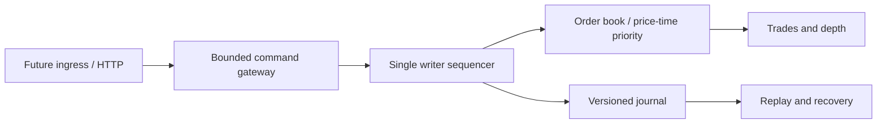

# MATCHLINE

**A deterministic exchange-style matching engine simulator, under development.**

MATCHLINE is a learning-oriented backend systems project focused on price-time priority, deterministic command ordering, crash recovery and measurable performance. It is **not** a trading venue; it never connects to an exchange or moves money.

> **Status: Commit 01 / bootstrap only.** The project currently has a runnable Java CLI and first unit tests. It does **not yet** place/cancel orders, match trades, store a journal, expose an HTTP API or serve a browser demo. Those are planned, not complete features.

## Canonical development environment

- **Source files:** WSL2 Ubuntu Linux filesystem, e.g. `~/Work/MATCHLINE` (not `/mnt/c/...`).
- **JDK:** a Linux JDK 21 installed in WSL and selected as the Project SDK in IntelliJ.
- **Build:** Gradle **8.14.3** via `./gradlew` / `gradlew.bat`; Gradle Kotlin DSL. You do not need system Gradle.
- **IDE:** IntelliJ IDEA Community, using the WSL JDK and Gradle wrapper.
- **Docker (optional for this commit):** Docker Desktop with WSL2 integration. The container runs a **one-shot CLI smoke test**, not a server.

**First-run wrapper binary:** The artifact sandbox cannot download binary files. Thus `gradle/wrapper/gradle-wrapper.jar` is intentionally supplied by a first-run **official, SHA-256-checked bootstrap** in `gradlew` or `gradlew.bat`. Run `./gradlew --version` once *before your first Git commit*: it creates the authentic JAR in `gradle/wrapper/`, and `git add -A` then includes it in your repository. The Gradle 8.14.3 distribution ZIP is also SHA-256 pinned. See [wrapper bootstrap details](gradle/wrapper/README.md). An internet connection is necessary for the first setup and Maven Central dependencies.

## Run and verify

```bash
java -version
chmod +x ./gradlew
./gradlew --version
./gradlew clean test
./gradlew run --args='--self-check'
./gradlew run --args='--version'
./gradlew installDist
./build/install/matchline/bin/matchline --self-check
```

Expected output from the self-check (JDK feature may be newer if you intentionally use a newer compatible JVM):

```text
MATCHLINE BOOTSTRAP OK | Java 21
matching=false http=false journal=false
```

Expected tests: **7 passing JUnit tests** (2 in `BootstrapStatusTest`, 5 in `MatchlineApplicationTest`). Gradle writes HTML test results to `build/reports/tests/test/index.html` and XML to `build/test-results/test/`.

There is no HTTP health endpoint yet. Running `curl localhost:8080` is **not** an appropriate test for Commit 01.

## Docker smoke test (optional)

```bash
docker compose --profile smoke run --build --rm matchline-smoke
```

The container builds the app, prints the same bootstrap OK message and exits successfully. It is **not** intended to stay running.

## Architecture (target, not present implementation)



Planned separation: core Java code holds domain rules; adapters handle HTTP and storage; state changes are made only by a sequenced writer per book. No database or network call enters the matching hot path. Nothing in the diagram should be read as shipped in Commit 01.

For the roadmap and design rationale, see [`docs/roadmap.md`](docs/roadmap.md) and [`docs/adr`](docs/adr). For Windows/WSL/IntelliJ steps and Git commands, see [`docs/COMMIT-01-HANDOFF.md`](docs/COMMIT-01-HANDOFF.md).

## Current limitations

- No matching operations or domain types.
- No HTTP API, SSE, persistence, replay, snapshot or benchmark.
- No production suitability, deployment URL, latency number or throughput claim.
- Bootstrapping requires internet access and a verified official Gradle wrapper JAR.

## License

MIT — see [`LICENSE`](LICENSE).
