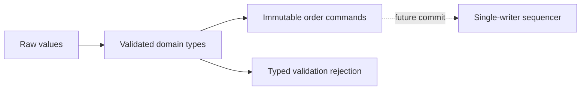

# Commit 02 — Manual handoff: validated order contracts

Commit 01 was tested and pushed by the user; the IntelliJ debugger gate was skipped.
Commit 02 changes Java domain sources, new JUnit tests, README and this documentation
only. It does NOT change the Gradle wrapper, bootstrapping CLI, Dockerfile or existing tests.

## Apply the change package

Repository directory: `~/Stuff/Projects/MATCHLINE` in WSL2.

**Preferred: apply the patch**, copied to the parent `~/Stuff/Projects/` first:

```bash
cd ~/Stuff/Projects/MATCHLINE
git status --short      # must show no unexpected changes
git apply --check ../MATCHLINE_Commit02.patch
git apply ../MATCHLINE_Commit02.patch
```

**Fallback: changed-files ZIP** (choose one method, not both):

```bash
cd ~/Stuff/Projects/MATCHLINE
unzip -o ../MATCHLINE_Commit02_Changes.zip -d .
```

ZIP paths are relative to the repository root. No files are intentionally removed.
The ZIP does not include or replace `gradle/wrapper/gradle-wrapper.jar`.
Keep any local changes you made after Commit 01 instead of overwriting them blindly;
if the patch does not apply, send the diff/error for a surgical fix.

## Commands and expected behavior

```bash
cd ~/Stuff/Projects/MATCHLINE
./gradlew clean test --console=plain
./gradlew run --args='--self-check' --console=plain
./gradlew run --args='--version' --console=plain
```

Expected: all Commit 01 tests and new domain tests pass, `BUILD SUCCESSFUL`.
The CLI self-check still reports **matching=false http=false journal=false**.
No server port is opened. `git diff --check` should show no whitespace errors.

Optional targeted tests:

```bash
./gradlew test --tests 'dev.matchline.domain.*' --console=plain
```

New test groups: ID grammar, instrument grammar, price tick boundaries and overflow,
quantity boundaries, side crossover arithmetic, command record contracts, rejection codes.

## Architecture map



The new domain types are data-only; nothing submits them to a running book.
A duplicate ID is reserved as a *future state-dependent rejection* and is not yet
checked. Do not interpret the type tests as evidence of matching correctness.

## Review before manual commit

```bash
git status --short
git diff --stat
git diff --check
git add -A
git diff --cached --check
git commit -m "feat: define bounded order command contracts"
git push
```

**Stop:** send the terminal test output and either the real commit hash or any
failures; no Commit 03 code should be applied on top of a failing Commit 02.
